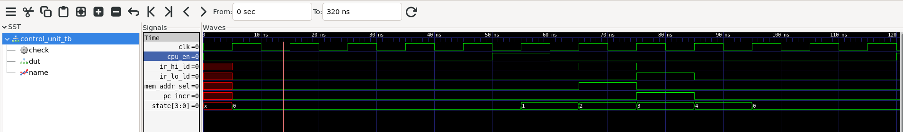

# Testbench boiler plate

```
`timescale 1ns / 1ps

module tb_name ;

    1. Parameters and clock period

    2. Signal declarations
    // Inputs to DUT are 'reg', outputs from DUT are 'wire'

    3. Instantiate the Design Under Test (DUT)
    my_module dut();

    4. Clock generation

    5. Waveform dumping, if you plan on having a waveform displayed in (eg.) gtkwave

    6. Test Stimulus

endmodule
```
## Confirmation of working control_unit_tb.v
